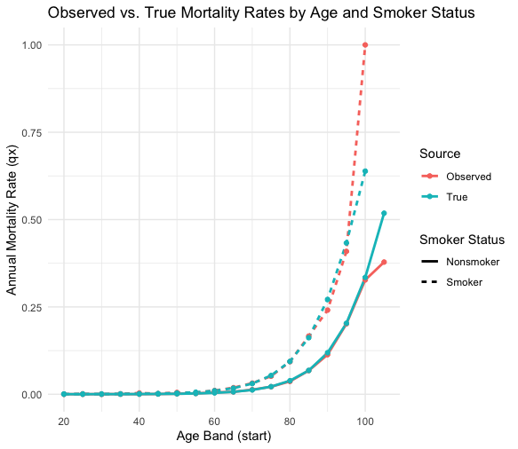
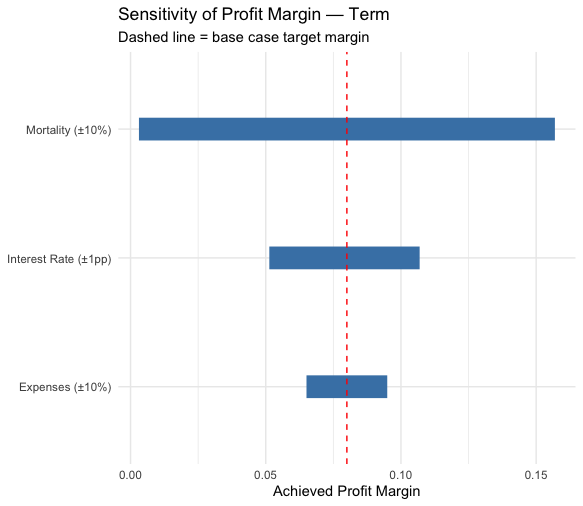
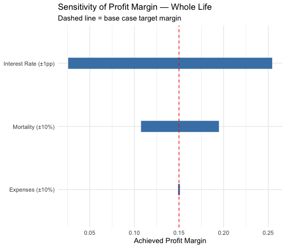
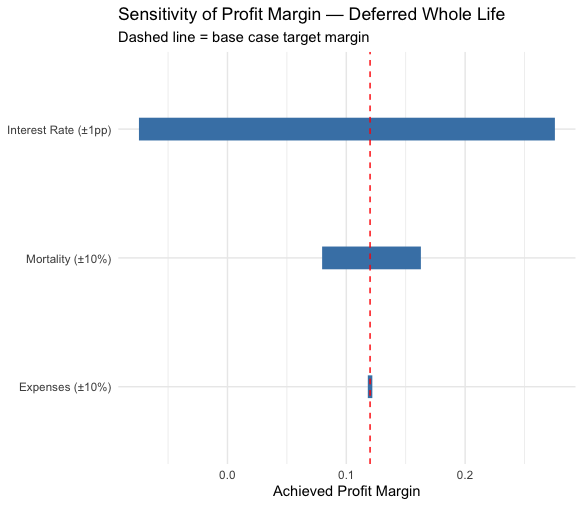

## Overview

Life insurers must set a premium today for a promise that may not be paid for decades. This project prices life insurance the way an actuary would from experience data. It generates a portfolio of 10,000 synthetic policies, studies the mortality they produce, turns that study into pricing assumptions, solves for the premium, and then tests how profitable the product stays when reality differs from the assumptions.

It covers three products: Term, Whole Life and Deferred Whole Life (a waiting period, then lifetime coverage). The data is synthetic, so no real or personal information is used. Because the true mortality pattern is known in advance, the accuracy of the mortality study can be measured directly.

The work runs through nine phases: pricing fundamentals, database design, synthetic data, a mortality study, assumptions, a pricing engine, profit testing, sensitivity analysis and a Shiny dashboard.

## Tools used

- **R** for simulation, the pricing engine, profit testing and charts, with dplyr, ggplot2, DBI, RSQLite and readxl
- **SQL (SQLite)** for the policy, exposure and death tables
- **Excel** for the assumptions workbook, kept separate from the code so any assumption can be changed
- **Shiny** for the pricing dashboard
- **Git and GitHub** for version control

## Key results

### The mortality study recovered the true pattern

Deaths divided by exposure, by 5-year age band and smoker status, tracks the mortality curve the data was generated from across ages 40 to 95. At age 65 the Nonsmoker rate is 0.696% observed against 0.700% true, and at age 80 the Smoker rate is 9.33% against 9.40%. The smoker-to-nonsmoker ratio stays close to the 2.5 times built into the simulation. At the youngest and oldest ages, exposure is thin and the observed rates become unreliable, which is a known feature of experience studies.

{fig-alt="Line chart of observed and true annual mortality rates by age band for smokers and nonsmokers. The lines track each other closely until the oldest ages, where observed rates become volatile." width=70%}

### Profit margins match their targets

Profit testing projects cash flows year by year and checks them against the pricing engine's premium. Across six test policies, every achieved margin matched its product's target: 8% for Term, 15% for Whole Life and 12% for Deferred Whole Life. An early version did not reconcile, giving $9.34 against a target of $17.20. The cause was a timing mismatch, and discounting each cash flow with its own timing fixed it.

### Each product has a different dominant risk

Sensitivity analysis prices each product once and then stresses the assumptions: mortality ±10%, interest rate ±1 percentage point and expenses ±10%. The table shows each product's profit margin under the adverse direction of each stress.

| Product | Base margin | Mortality +10% | Interest rate −1 point | Expenses +10% |
|---|---|---|---|---|
| Term | 8.00% | 0.31% | 5.13% | 6.51% |
| Whole Life | 15.00% | 10.75% | 2.58% | 14.90% |
| Deferred Whole Life | 12.00% | 7.97% | −7.45% | 11.81% |

Term is most exposed to mortality: a 10% rise takes its margin from 8.00% to 0.31%. Whole Life and Deferred Whole Life are most exposed to interest rates, because their cash flows run for decades, and a 1 point fall takes Deferred Whole Life below zero. Expenses matter least for every product. The charts below show the full range for each product.

::: {.panel-tabset}

## Term

{fig-alt="Bar chart ranking three stressed assumptions for Term. Mortality has the widest range, then interest rate, then expenses, with a dashed line at the 8 percent target margin." width=70%}

## Whole Life

{fig-alt="Bar chart ranking three stressed assumptions for Whole Life. Interest rate has the widest range, then mortality, then expenses, with a dashed line at the 15 percent target margin." width=70%}

## Deferred Whole Life

{fig-alt="Bar chart ranking three stressed assumptions for Deferred Whole Life. Interest rate has the widest range, then mortality, then expenses, with a dashed line at the 12 percent target margin." width=70%}

:::

## Limitations and assumptions

- The data is synthetic, so the results show that the method works, not how a real insurer's mortality behaves.
- The "true" mortality pattern is a Gompertz-Makeham curve with parameters from course material. That is an assumption of the model.
- Cash flows use expected values rather than a simulation of individual policies, and premiums are level.
- Exposure is thin at the oldest ages (95 and above), so observed rates there are volatile. Ages are grouped into 5-year bands.
- Sensitivity was run on one representative policy per product, with single shocks (mortality ±10%, interest rate ±1 point, expenses ±10%), not combined stresses.
- The dashboard prices at a fixed 5% interest rate and runs locally in RStudio. It is not hosted online.

## What I learned

- A model can run without errors and still be wrong. Reconciling two independent calculations, the premium solve and the cash flow projection, caught a discounting mistake that neither would have shown alone.
- Price once, test many times. Re-solving the premium under each stress answers the wrong question, because sensitivity testing should hold the premium fixed.
- Stress tests need checking too. My first mortality stress changed nothing, because the stressed table never reached the calculations. Checking each function in the chain in turn found the gap.
- A Shiny interface can sit on top of a verified engine without changing its logic.

```{=html}
<p class="mt-4"><a href="https://github.com/Act-MeetPatel/life-insurance-pricing-model" class="btn btn-primary" target="_blank" rel="noopener">View on GitHub</a></p>
```