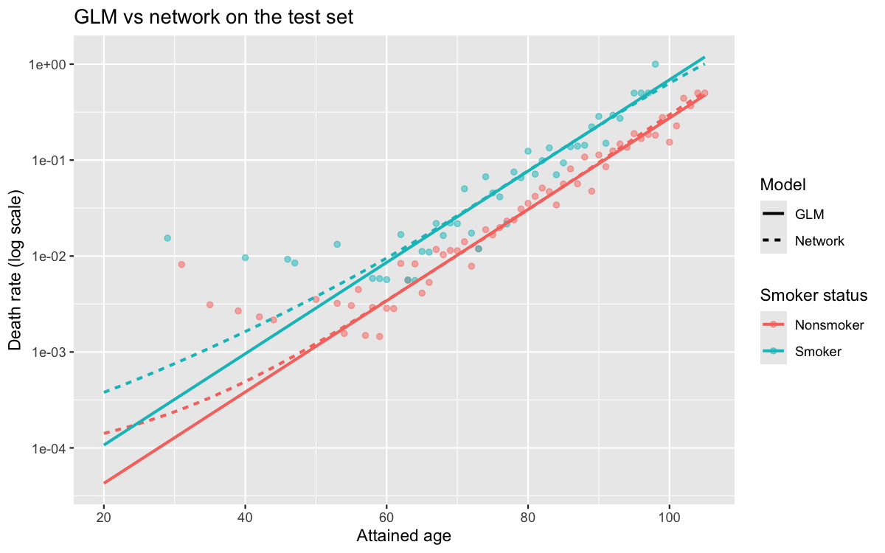
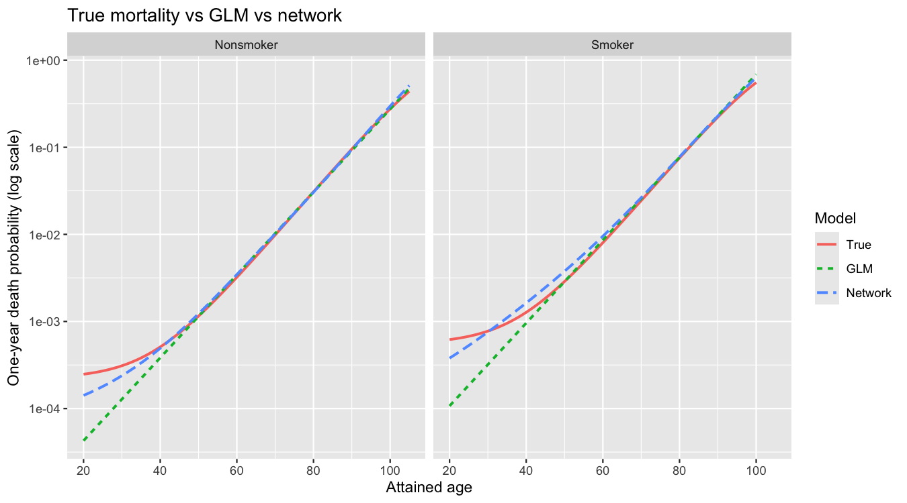

## Overview

This project asks a simple question: can a small neural network do better? I built the network from scratch in R, rebuilt it with torch, and compared it with a Poisson GLM and with the true mortality formula that generated the data.

The data is synthetic life insurance experience from my pricing project: 10,000 policies and 6,512 deaths, simulated from a Gompertz-Makeham law with a 2.5 times smoker multiplier. Because the true mortality is known, every model can be checked against it.

The network has two inputs (age and a smoker flag), one hidden layer of 8 neurons and one output, 33 parameters in all. It is trained with a Poisson deviance loss, which measures how far predicted deaths are from actual deaths.

## Tools used

- **R**, with the network's forward and backward passes written by hand in base R
- **torch** for rebuilding the same network and checking the hand-built one
- **DBI and RSQLite** for pulling the data from the pricing project's database
- **ggplot2** for the charts
- **Git and GitHub** for version control

## Key results

### On the test set, the network tied the GLM

Policies were split at random into train (70%), validation (15%) and test (15%) before grouping by age and smoker status. The test set was scored once, at the end, and the network was not changed afterwards. I set the rule in advance that a gap smaller than 0.01 per group counts as a tie. The table shows mean Poisson deviance per group, where lower is better.

| Set | GLM | Network |
|---|---|---|
| Train | 0.9733 | 0.9149 |
| Validation | 0.8630 | 0.8522 |
| Test | 0.8479 | 0.8484 |

The network's edge shrinks from train to validation to test, and is gone on the test set (165 groups, 970 deaths).

{fig-alt="Log-scale chart of death rate against attained age on the test set. Observed rates for smokers and nonsmokers are shown as dots, with fitted GLM and network curves. The two models are nearly identical from about age 55 to 95 and differ below about age 45." width=80%}

### Against the true curve, each model wins in different places

Because the formula that generated the data is known, I could measure how close each model is to the truth. A GLM with age as a straight term cannot represent the constant (Makeham) part of the formula, so it underestimates young-age mortality. At ages 20 to 39 it expects about half the true deaths, while the network expects about 94%. The GLM is closer in the middle ages, and overall the two are equally close to the truth (total distance 10.90 for the GLM and 11.36 for the network).

| Age band | Closer to the truth |
|---|---|
| 20-39 | Network |
| 40-59 | GLM |
| 60-79 | GLM |
| 80-99 | Network |
| 100-105 | GLM (little exposure) |

{fig-alt="Two panels, nonsmokers and smokers, plotting one-year death probability on a log scale against age for the true formula, the GLM and the network. All three agree from about age 50. At younger ages the true curve flattens, the GLM keeps falling, and the network sits in between." width=90%}

### The hand-built network was verified

Its backward pass was checked against a numerical gradient (agreement about 1e-9) and later against torch's automatic gradients (about 1e-14). A torch rebuild trained from the same starting point matches the hand-built network to about 1e-12.

## Limitations and assumptions

- The data is synthetic, so the results describe how the models behave on this data, not real mortality.
- There is one random split, one network design and one final seed. A different split could give a different test gap.
- Validation loss was used to choose the stopping round and the learning rate, so validation scores are slightly optimistic. Only the test score is an independent check.
- The GLM is deliberately simple. A richer GLM, for example with an age-squared term, might close the young-age gap. I did not test that.
- The network predicts about 2.2% too many deaths overall, because training stopped before its overall level was fully fitted. I did not retune it after seeing the test result. Its smoker-to-nonsmoker ratio also drifts with age (about 3.3 at age 40, against a true 2.5), and I did not investigate why.
- Across five random starting seeds, four finished and agree on validation loss within 0.002. One had not finished after 150,000 rounds.
- I assumed the formula in my pricing project's code is the one that generated the data. The GLM recovering the 2.5 smoker multiplier supports this.

## What I learned

- A model that beats the benchmark in training may not beat it on new data. The network's advantage shrank from 0.058 per group on the training set to 0.011 on validation and zero on test.
- Set the rules before looking at the test result. I fixed the tie threshold and the plan to score the test set once beforehand, so the result could not be bent to look better.
- Compare with the truth when you can. The test set is noisy, and it hid a young-age gap that the known formula showed clearly.
- A neural network is not automatically better. When the data varies only by age and smoker status, a simple GLM can be just as good.

```{=html}
<p class="mt-4"><a href="https://github.com/Act-MeetPatel/mortality-neural-network" class="btn btn-primary" target="_blank" rel="noopener">View on GitHub</a></p>
```