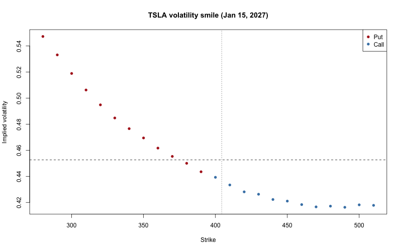
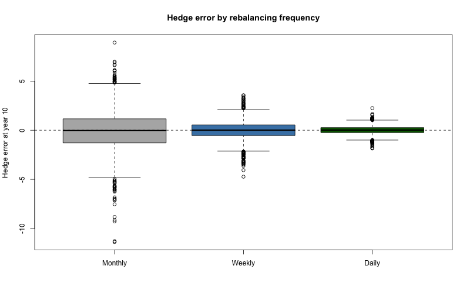

## Overview

A segregated fund guarantee promises the policyholder at least their money back at maturity. That makes it a put option the insurer has sold. This project builds an option pricing engine in R to price that promise. It prices options three independent ways, a binomial tree, the Black-Scholes formula and Monte Carlo simulation, and checks them against each other. It then tests the models on real Tesla option data and applies them to the guarantee: its price, the fair fee, a delta hedge and a tail reserve.

The project ends in a three-tab Shiny app and a written report.

## Tools used

- **R** for the pricing functions, simulations, hedging and charts, with quantmod for market data
- **Shiny** for a three-tab app covering pricing, market data and the seg fund guarantee
- **Quarto** for the written report
- **Git and GitHub** for version control

## Key results

### Three methods that check each other

The tree handles American options, the formula is exact for European ones and gives the Greeks, and simulation handles products that depend on the path, such as Asian and barrier options. For the same European call (stock 100, strike 100, rate 5%, dividend yield 2%, volatility 20%, one year), they agree closely.

| Method | European call price |
|---|---|
| Binomial tree, 500 steps | 9.2231 |
| Black-Scholes formula | 9.2270 |
| Monte Carlo, control variate | 9.2553 (standard error 0.018) |

Put-call parity held to rounding error, and every Greek matched a direct nudge calculation. A control variate cut the simulation error by about 59% compared with plain Monte Carlo.

### Real Tesla data shows what one volatility cannot capture

I tested the models on Tesla options expiring in January 2027, saved on 2 November 2026. Most quotes were unusable, and put-call parity showed that the downloaded stock price did not match the price the options were quoted at. Implied volatility near the money was about 44%, against historical volatility of 36% (30 days), 51% (90 days) and 45% (about a year). It also formed a smile, from about 55% at the lowest strikes to about 42% at the highest. A single constant volatility cannot match that.

{fig-alt="Scatter chart of implied volatility against strike for Tesla January 2027 options. Put options at lower strikes show implied volatility of about 55 percent, falling steadily to about 42 percent at higher strikes, where call options sit." width=70%}

### Pricing the segregated fund guarantee

The guarantee pays the shortfall between the fund and the guaranteed 100 at maturity. For a 10-year policy, with a 3.8% interest rate and 20% volatility, the results per 100 invested are below.

| Result | Without mortality and lapses | With mortality and lapses |
|---|---|---|
| Cost of the guarantee | 13.77 | 8.08 |
| CTE95 reserve per 100 sold | 38.6 | 21.6 |

The fair yearly fee for the guarantee alone is about 0.79%. A weekly delta hedge removed about 95% of the risk, and the hedge error shrinks as rebalancing becomes more frequent. The reserve is far above the price because they answer different questions: the price is a risk-neutral value, and the reserve is capital for a bad market.

{fig-alt="Box plots of hedge error at year 10 for monthly, weekly and daily rebalancing. The spread of errors is widest for monthly and narrowest for daily, and all are centred near zero." width=70%}

## Limitations and assumptions

- Most seg fund inputs are assumptions, not data: volatility, expected return and lapse rate. The results move a lot with them. One point of interest rate moves the cost of the guarantee by about 25% to 30%.
- Black-Scholes is a formula for European options, and Tesla's options are American. I did not measure the difference.
- Volatility is a single constant in the models, while real options show a smile.
- In the seg fund model, lapses are independent of the market and the pool of policies is large. Both are assumptions, and both probably understate the cost.
- The CTE reserve illustrates a tail measure. It is not the regulatory formula.
- Market data comes from Yahoo Finance and can lag by a day. The Shiny app runs locally in RStudio and is not published online.

## What I learned

- Passing tests can still hide bugs. An Asian option with one monitoring step must equal the plain call, and it did not, because R had flattened a one-column matrix. The ordinary tests had passed.
- A wrong sign can look plausible. My barrier correction moved the barrier the wrong way and gave 8.42, while the exact formula gave 7.587 and the corrected simulation matched it.
- Real data is messy, and parity checks help. They exposed a mismatch between the stock price and the price the options were quoted at.
- Assumptions drive the answer. The honest way to present a result like the guarantee's cost is to show how much it moves with each input.

```{=html}
<p class="mt-4">
  <a href="https://github.com/Act-MeetPatel/options-pricing-engine" class="btn btn-primary" target="_blank" rel="noopener">View on GitHub</a>
  <a href="https://act-meetpatel.github.io/options-pricing-engine/" class="btn btn-outline-primary ms-2" target="_blank" rel="noopener">Read the report</a>
</p>
```